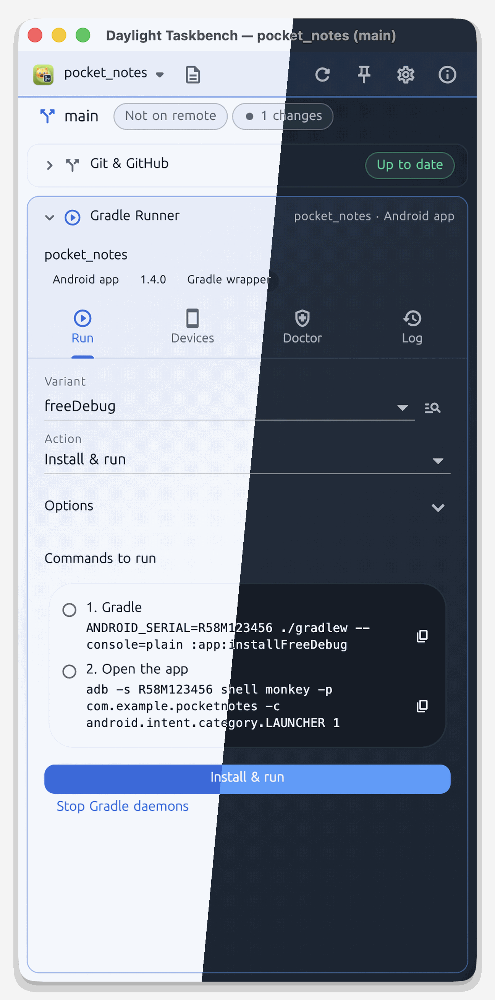

<!-- From jejezz/application-release-templates common/tool/readme @ conventions-v1.
     tool/readme/init_readme.py가 만든 파일입니다 — conventions/readme-guide.md 참고.
     {{TODO: …}}를 모두 채우십시오. 하나라도 남아 있으면 tool/readme/check_readme.py가 실패합니다. -->

<p align="center">
  
</p>

<h1 align="center">Daylight Taskbench</h1>

<p align="center">
  편집기 옆에 세워 두는 **Flutter 앱용 GitHub 작업대** — Git·GitHub 도구와 실기기 빌드·설치를 한 창에서.
</p>

<p align="center">
  <a href="https://github.com/jejezz/daylight-taskbench/releases/latest"></a>
  <a href="https://github.com/jejezz/daylight-taskbench/releases"></a>
  
  
  <a href="LICENSE"></a>
</p>

<p align="center">
  <a href="README.md">English</a> · <b>한국어</b>
</p>

<p align="center">
  
</p>

## 기능

- **폴더 하나, Dock 여럿** — Git 폴더를 한 번 고르거나 끌어다 놓으면 공유 막대에 폴더, 현재 브랜치, "편집기에서 열기"가 나오고 모든 Dock이 따라갑니다. 앱 안에서든 터미널에서든 브랜치를 바꾸면 모든 Dock이 함께 갱신됩니다.
- **Git & GitHub** — 변경과 커밋 상자, 브랜치, 태그, 원격, 안내식 릴리스 흐름, PR, CI 실행, 기록 그래프, 충돌·임시 저장 복구. 실제 `git`과 `gh`를 실행하고 명령을 그대로 보여 줍니다.
- **Flutter Runner: 실기기 빌드·설치** — 폴더(또는 한 단계 아래)에서 Flutter 프로젝트를 찾아 USB iPhone, Android 폰, 이 컴퓨터에 빌드·설치하고, 실행 중에는 핫 리로드를 보냅니다. 점검 탭이 Flutter, Xcode, adb, 서명 인증서·프로파일을 확인합니다.
- **Gradle Runner: Android 앱·JVM 프로젝트** — 폴더(또는 한 단계 아래)에서 Gradle 프로젝트를 찾습니다 (Flutter 프로젝트의 `android/` 폴더는 Flutter Runner가 맡습니다). Android 앱은 APK·번들을 만들고 USB 기기나 켜진 에뮬레이터에 설치해 앱을 엽니다. 그 밖의 Gradle 프로젝트는 빌드·테스트·실행과 검색되는 작업 목록을 줍니다. 점검 탭이 JDK, Android SDK, 라이선스, adb, 릴리스 서명을 확인하고, 찾은 JDK·SDK 위치를 Gradle에 `JAVA_HOME`·`ANDROID_HOME`으로 넘깁니다.
- **도킹을 위한 창** — 편집기 옆에 세우는 440×960 창(최소 380×560)이고 위치를 기억합니다. 실행기 Dock(Rust, Electron 등)은 레지스트리에 한 줄이면 더해집니다.
- **작업대로 확장** — 상단 막대의 패널 버튼으로 **파일 탐색기**, **코드 에디터**, **터미널**을 같은 도크 열 왼쪽에 붙입니다. 창이 넓어질 뿐 도크 열은 그대로입니다. 각 패널에는 닫기 버튼이 있고 너비를 끌어 바꿀 수 있으며, 에디터와 터미널은 가운데를 나눠 쓰고 전환 버튼으로 바꿉니다. 패널을 모두 끄면 좁은 도킹 창으로 돌아오고, 앱은 항상 도킹 모드로 시작합니다.
- **내장 에디터는 선택** — 구문 강조, 탭, 찾기, 서식(Dart·JSON), Markdown 미리보기, 들여쓰기 안내선, 저장 시 서식. 설정에서 *내장 에디터 사용*을 끄면 파일을 계속 VS Code(또는 설정한 편집기 명령)로 엽니다. 종료할 때와 브랜치를 바꿀 때 저장하지 않은 수정을 지켜 줍니다.
- **빌드 오류에서 코드로** — 명령의 전체 출력에 나오는 파일 위치(`lib/main.dart:12:5`, `package:…`)가 링크가 되어 그 줄로 열립니다.
- **단축키** — `⌘/Ctrl+Shift+E` 탐색기, `⌘/Ctrl+Shift+D` 에디터, `Ctrl+\`` 터미널, `⌘/Ctrl+Shift+O` 파일 이름으로 열기. 메뉴에 표시됩니다.
- **라이트·다크, 한국어·English** — 시스템 설정을 따르거나 설정에서 고릅니다 (색 구성, 글자 크기, 고대비)

> Daylight Taskbench는 따로 배포하던 **Branch Dock**·**Flutty Dock** 앱과 **Daylight Workbench**를 대신합니다(Workbench의 탐색기·에디터·터미널은 선택 패널로 들어왔고, 병합 전 검증 관문은 가져오지 않았습니다). 이 앱들은 더 이상 개발하지 않습니다.

<p align="center">
  
  
  
</p>

## 설치

[**Releases**](https://github.com/jejezz/daylight-taskbench/releases/latest)에서 받습니다.

| OS | 파일 |
|---|---|
| macOS 12.0 이상 | `DaylightTaskbench-<버전>-macos-universal.dmg` — 열어서 앱을 Applications 폴더로 끌어다 놓으세요 |
| Windows 10/11 (x64) | `DaylightTaskbench-<버전>-windows-x64-setup.exe` |

**Windows:** 설치 프로그램에 아직 코드 서명이 없어서 SmartScreen이 "Windows의 PC 보호" 창을 띄웁니다. **추가 정보 → 실행**을 누르세요.

## 동작 방식

Daylight Taskbench는 Git이나 Flutter 도구를 다시 만들지 않습니다. 설치된 `git`, `gh`, `flutter`, `gradle`(또는 프로젝트의 래퍼), `adb`를 실행하고 그 출력을 보여 줄 뿐입니다. 하나의 워크스페이스 객체가 저장소의 HEAD를 지켜보다가 브랜치, 커밋, 병합 상태가 바뀌면 접혀 있는 Dock까지 모두에게 알립니다. 이미 실행 중인 빌드는 브랜치를 바꿔도 멈추지 않고 알림만 띄웁니다.

## 개발

```bash
flutter pub get
flutter run -d macos
```

Flutter(stable)가 필요하고, Dock이 쓰는 `git`과 선택적으로 `gh`, `flutter`, `adb`가 PATH에 있어야 합니다 (경로는 설정 → 도구에서 지정할 수 있습니다). macOS와 Windows만 지원합니다. 설계와 결정: [PLAN.md](PLAN.md).

릴리스: `scripts/bump-version.sh patch` → 병합 → `vX.Y.Z` 태그. CI가 모든 플랫폼을 빌드해서 올립니다. 규칙: [application-release-templates/conventions](https://github.com/jejezz/application-release-templates/tree/main/conventions).

## 크레딧

- 글꼴: [서울남산체](https://www.seoul.go.kr/seoul/font.do) (서울특별시)
- 아이콘: [Icons8](https://icons8.com)

## 라이선스

[MIT](LICENSE) © 2026 Jongyun Ahn
